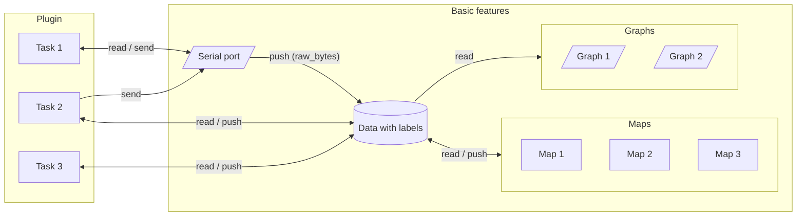

# Concept

Serval makes no demands on what your device sends.
It takes what it receives as it is, and turns it into data as you tell it to.

* **[Data](data-types.md)**: values under **labels**, each label holding one
  **type**, each value with the time it arrived.
* **[Maps](maps.md)**: turn the values of labels into values of other labels.
* **[Graphs](../usage/graph.md)**: plot labels, each graph showing the types it supports.
* **[Tasks](tasks.md)**: scripts of your own, which read and push data, and talk to the port.
