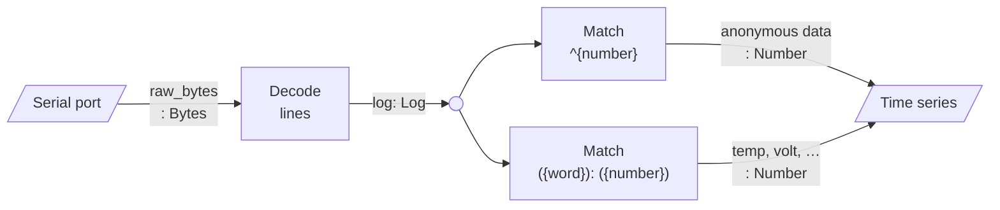

# Maps

A map takes the values of its input labels, and gives a value to its output
label as each one arrives.
Maps are chained by their labels: the output of one is the input of the next.

Most of them read text with a [regular expression](../reference/maps.md#regular-expressions),
so they can take whatever format your device writes.

## The default layout

Serval starts with three maps and a graph:



1. **Decode** splits the received bytes into lines; a line of `[LEVEL] message` gets its level, and the rest get none.
2. **Match** (`^{number}`) takes a log that starts with a number and pushes that number to `anonymous data`.
3. **Match** (`({word}): ({number})`) takes `name: value` and pushes `value`, as a number, to the label `name`.
4. **Time series** plots all the numbers shown in the data list.

For example, from a device that prints

```text
[INFO] started
temp: 22.5
volt: 3.31
42
```

Serval makes:

| Label | Type | Values |
|---|---|---|
| `log` | Log | `INFO started`, `temp: 22.5`, `volt: 3.31`, `42` |
| `temp` | Number | `22.5` |
| `volt` | Number | `3.31` |
| `anonymous data` | Number | `42` |

Change the maps, or add your own, in the [Data tab](../usage/data.md#maps).
